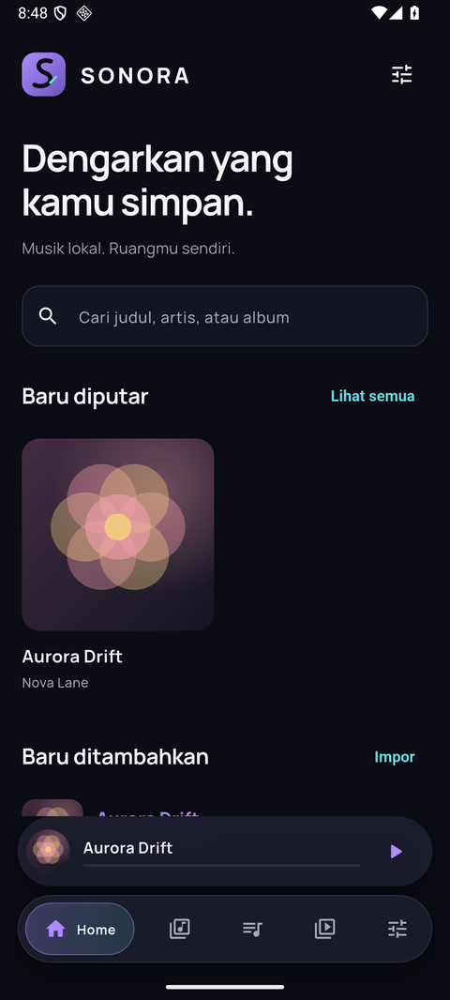
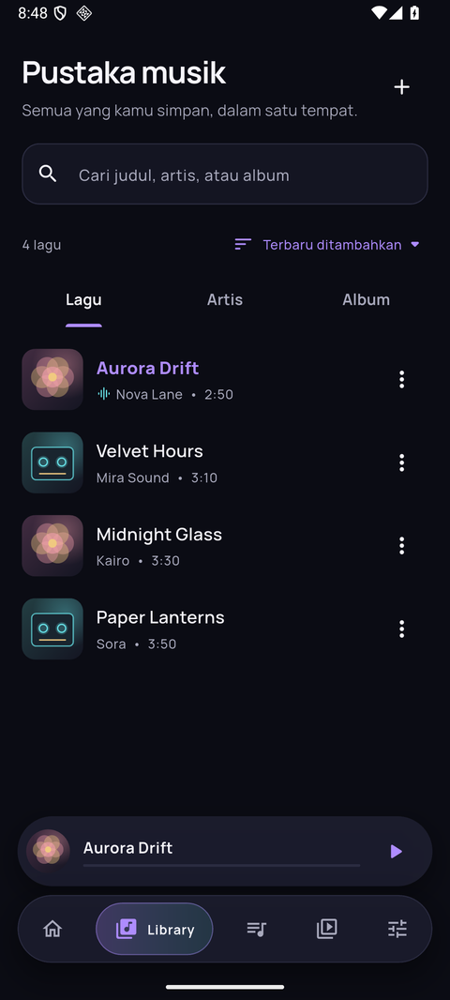
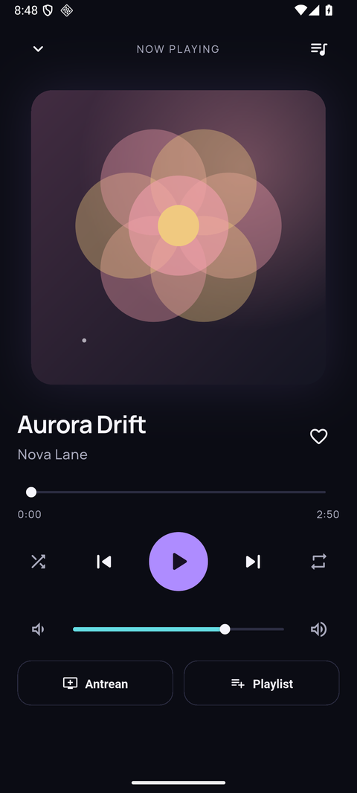
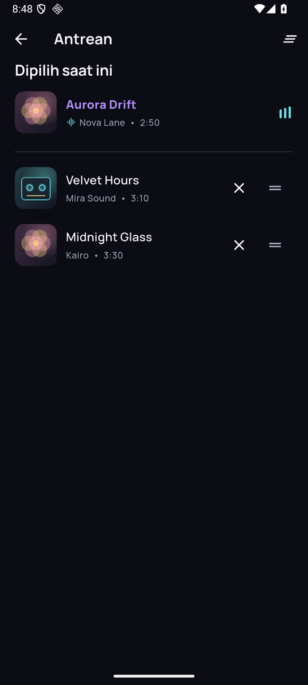
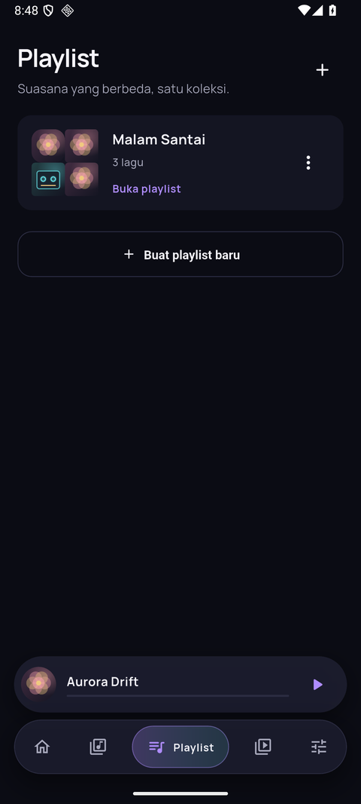
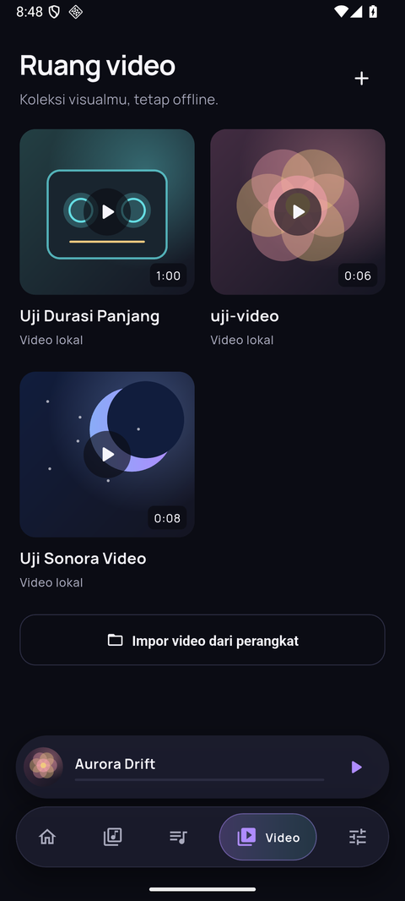
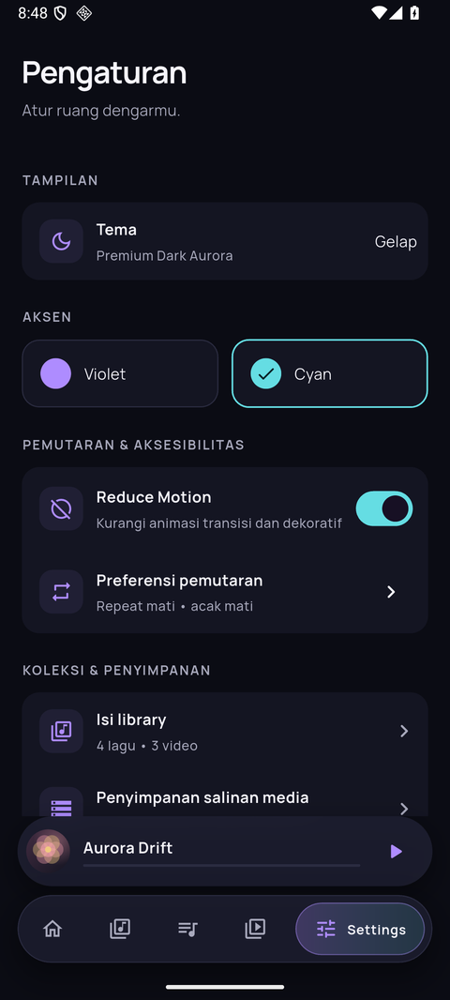

<p align="center">
  <picture>
    <source media="(prefers-color-scheme: dark)" srcset="docs/assets/sonora-logo.png">
    
  </picture>
</p>

<p align="center">
  <a href="#teknologi"></a>
  <a href="#teknologi"></a>
  <a href="#teknologi"></a>
  <a href="#teknologi"></a>
  <a href="#teknologi"></a>
  <a href="#teknologi"></a>
</p>

<p align="center">
  <a href="#status-100--mvp-lengkap"></a>
  <a href="#teknologi"></a>
  <a href="#pengujian"></a>
  <a href="LICENSE"></a>
</p>

# SONORA

<p align="center">
  <a href="#status-100--mvp-lengkap">Fitur</a> ·
  <a href="#tangkapan-layar">Tangkapan layar</a> ·
  <a href="#teknologi">Teknologi</a> ·
  <a href="#arsitektur">Arsitektur</a> ·
  <a href="#pengujian">Pengujian</a> ·
  <a href="#log-perubahan">Log perubahan</a>
</p>

SONORA adalah pemutar musik dan video **lokal** untuk Android dengan tema **Premium Dark Aurora**. Proyek ini menggunakan Flutter dan Dart, berjalan sepenuhnya offline, dan tidak memiliki akun, server, maupun telemetri.

## Tangkapan layar

Ketujuh layar diambil dari emulator Android 16 (1080 × 2400) pada 23 November 2026, memakai
aplikasi versi 1.0.0 dengan empat lagu dan tiga video hasil impor.

| | | |
|:---:|:---:|:---:|
|  |  |  |
| **Beranda** — sapaan, pencarian, dan rak terbaru | **Pustaka musik** — tab lagu, artis, album | **Now Playing** — kontrol lengkap dan volume |
|  |  |  |
| **Antrean** — trek aktif dan urutan berikutnya | **Playlist** — koleksi tersimpan per suasana | **Ruang video** — pustaka video lokal |
|  | | |
| **Pengaturan** — tema, aksen, Reduce Motion, isi library | | |

## Status: 1.0.0 — MVP lengkap

Seluruh butir MVP pada PRD (`~/Unduhan/prd.md`) sudah diimplementasikan: impor media dari perangkat, pemutaran MP3 dan MP4, antrean dan playlist yang tersimpan, notifikasi media, serta pemulihan posisi terakhir.

Yang tersedia:

- **Impor media** melalui pemilih berkas sistem (Storage Access Framework) untuk audio
  (MP3, M4A, AAC, WAV, FLAC, OGG, OPUS) dan video (MP4, M4V, MKV, WEBM, 3GP), dengan
  ringkasan hasil: berhasil, duplikat, dan tidak didukung. Salinan yang kosong atau
  terpotong ditolak sebagai berkas tidak didukung, dan satu berkas gagal tidak membatalkan
  berkas lain dalam satu kali impor.
- **Metadata lokal**: judul, artis, album, durasi, dan cover di dalam berkas dibaca
  langsung di perangkat. Bila tag tidak ada, nama berkas dipakai sebagai judul.
- **Pemutaran audio** dengan play/pause, seek, volume, previous/next, shuffle, dan repeat
  (`off` berhenti di ujung antrean, `all` kembali ke awal, `one` mengulang trek aktif).
- **Pemutaran background** dengan notifikasi media, kontrol headset, dan kontrol layar kunci
  (`audio_service` + `just_audio`).
- **Pemutar video** dengan play/pause, seek, volume, dan mode layar penuh. Musik dijeda
  otomatis ketika video diputar agar hanya ada satu sumber audio.
- **Library** dengan pencarian, pengurutan, dan pengelompokan per artis/album.
- **Playlist** dengan buat, ubah nama, hapus, tambah/hapus lagu, dan ubah urutan (drag).
- **Antrean** persisten dengan tambah, hapus, ubah urutan, dan kosongkan.
- **Persistensi**: media, playlist, antrean, riwayat putar, favorit, dan preferensi
  (aksen, Reduce Motion, repeat, shuffle, volume, posisi terakhir) bertahan setelah
  aplikasi ditutup.
- **Navigasi dynamic island**: kapsul mengambang dengan item aktif yang mengembang,
  mini player menempel di atasnya, dan label otomatis ringkas pada layar sempit atau
  skala teks besar.
- Empty state, status impor, dan pesan kesalahan yang spesifik berbahasa Indonesia.

Batas yang masih berlaku (jujur, bukan bug):

- Video belum menampilkan thumbnail dari frame video; kartu video memakai artwork
  prosedural. Posisi video tidak dilanjutkan setelah keluar dari pemutar.
- Tidak ada Picture-in-Picture, equalizer, atau lirik. Tidak ada streaming, akun, atau
  sinkronisasi cloud (di luar cakupan MVP menurut PRD bagian 4).
- Build yang dihasilkan masih **debug** (ditandatangani kunci debug), bukan paket rilis
  siap distribusi.

## Keputusan penting

- **Salinan berkas saat impor.** Pemilih berkas Android memberi akses sementara, sehingga
  SONORA menyalin berkas terpilih ke penyimpanan aplikasi (`<app support>/media`). Tanpa
  salinan, media tidak dapat diputar lagi setelah pemilih ditutup atau perangkat dimulai
  ulang. Berkas **asli tidak pernah dipindahkan, diubah, atau dihapus**.
- **Salinan diverifikasi setelah disalin.** Ukuran salinan dibandingkan dengan ukuran berkas
  sumber; salinan nol byte atau tidak utuh dihapus dan dilaporkan sebagai berkas tidak
  didukung. Penyedia dokumen kadang mengembalikan stream kosong tanpa galat, dan tanpa
  pemeriksaan ini baris library tercatat "tersedia" padahal berkasnya tidak bisa diputar.
- **Ketersediaan diperiksa saat aplikasi dibuka.** Salinan milik SONORA yang berkasnya sudah
  hilang ditandai tidak tersedia pada startup, sehingga library menampilkan "Berkas tidak
  ditemukan" tanpa menunggu pengguna menekan putar. URI di luar direktori media aplikasi
  tidak diperiksa.
- **Hapus dari library** menghapus baris database, salinan aplikasi, dan cover hasil
  ekstraksi. Berkas asli di perangkat tetap utuh.
- **Duplikat** dikenali dari isi berkas (SHA-256), bukan dari namanya. Berkas yang sama
  dengan nama berbeda — misalnya `lagu.mp3` lalu `lagu (1).mp3` — tetap ditolak, sedangkan
  dua berkas berbeda yang kebetulan bernama dan berukuran sama tetap diterima. Pembandingan
  hanya dilakukan terhadap baris yang ukurannya sama, dan berkas yang sudah hilang
  dibandingkan lewat nama sebagai cadangan agar impor ulang tetap mungkin.
- **Impor ganda tidak mungkin terjadi.** Baris library dan salinan berkas baru dibuat setelah
  pemeriksaan duplikat, dan salinan untuk berkas yang ditolak langsung dihapus, sehingga tidak
  ada salinan yatim yang menumpuk.
- **Shuffle** memakai urutan deterministik yang stabil: item yang sudah ada mempertahankan
  posisinya, item baru masuk di belakang, dan tidak ada item yang hilang.
- **Pemulihan posisi** tidak memutar otomatis. Aplikasi membuka trek terakhir dalam keadaan
  dijeda agar tidak mengejutkan pengguna.
- **Tombol putar video** memeriksa posisi lebih dulu: bila video sudah berada di ujung,
  pemutaran dimulai lagi dari awal; bila belum, pemutaran berlanjut dari posisi terakhir.
- **Izin**: aplikasi hanya meminta izin notifikasi (Android 13+) saat pemutaran pertama.
  Akses berkas memakai pemilih sistem sehingga tidak meminta izin seluruh penyimpanan.

## Arsitektur

```text
lib/
├── main.dart                      # startup: audio service, backend, state, MaterialApp
└── src/
    ├── app_state.dart             # SonoraState: library, playlist, antrean, pemutaran
    ├── app_shell.dart             # lima layar + dynamic island + mini player
    ├── theme.dart                 # token warna, tipografi, transisi (Reduce Motion)
    ├── artwork.dart               # monogram, artwork prosedural, ilustrasi, equalizer
    ├── data/
    │   ├── database.dart          # skema Drift (PRD bagian 7)
    │   ├── repositories.dart      # media, playlist, antrean, playback state, settings
    │   ├── backend.dart           # pembuka database + pemilik repository
    │   └── models.dart            # MediaDraft, ImportReport, PlaylistSummary
    ├── media/
    │   ├── media_item.dart        # model media untuk UI
    │   ├── media_library.dart     # picker, penyimpanan aplikasi, alur impor/hapus
    │   └── media_metadata.dart    # pembaca tag ID3/Vorbis/MP4
    ├── playback/
    │   ├── audio_engine.dart      # kontrak mesin audio + implementasi tiruan
    │   ├── audio_handler.dart     # audio_service handler + adapter just_audio
    │   └── notification_permission.dart
    ├── screens/                   # home, library, playlists, videos, player, settings
    └── widgets/
        ├── shared.dart            # komponen bersama + alur impor
        └── dynamic_island_nav.dart
```

"Backend" pada aplikasi ini berarti lapisan layanan dan penyimpanan **lokal**, bukan
server; PRD bagian 11 menyatakan server tidak diperlukan untuk MVP.

### Skema database

`media_items`, `playlists`, `playlist_items`, `playback_state`, `queue_items`,
`app_settings` — foreign key aktif, constraint di level SQL, dan `schemaVersion` untuk
migrasi. Regenerasi kode Drift setelah mengubah skema:

```bash
dart run build_runner build
```

## Teknologi

Versi diambil dari `pubspec.yaml`, `android/settings.gradle.kts`, dan `flutter --version`
pada 23 November 2026.

| Lapisan | Teknologi | Versi | Dipakai untuk |
|---|---|---|---|
| Bahasa & UI | Flutter / Dart | 3.47.8 / SDK ^3.13.7 | seluruh antarmuka dan logika aplikasi |
| Pemutaran audio | `just_audio` | 0.10.6 | MP3, M4A, AAC, WAV, FLAC, OGG, OPUS |
| Latar belakang | `audio_service` | 0.18.19 | foreground service, `MediaSession`, notifikasi media, tombol headset |
| Fokus audio | `audio_session` | 0.2.4 | mengalah pada panggilan/audio lain |
| Pemutaran video | `video_player` | 2.14.1 | MP4, M4V, MKV, WEBM, 3GP (ExoPlayer) |
| Basis data | `drift` + `drift_flutter` | 2.35.3 / 0.3.1 | SQLite bertipe dengan migrasi skema |
| Metadata | `audio_metadata_reader` | 1.8.1 | tag ID3/Vorbis/MP4 dan cover |
| Pemilih berkas | `file_picker` | 13.3.0 | Storage Access Framework |
| Izin runtime | `permission_handler` | 12.0.0 | `POST_NOTIFICATIONS` saat pemutaran pertama |
| Direktori aplikasi | `path_provider` | 2.1.6 | `<app support>/media` dan lokasi basis data |
| Identitas | `uuid` | 4.6.0 | ID media, playlist, dan antrean |
| Android | AGP / Kotlin / JVM | 9.1.0 / 2.4.0 / 17 | `minSdk` 24, `targetSdk` 36, `applicationId` `id.sonora.sonora` |
| IDE | Android Studio | 2026.2 (AI-262) | menjalankan emulator dan profiler |
| Tipografi | Manrope | dibundel | lisensi SIL OFL, `assets/fonts/OFL.txt` |

Tidak ada dependensi jaringan: seluruh paket dipakai di perangkat, tanpa SDK iklan, analitik,
atau layanan awan.

## Menjalankan pemeriksaan

```bash
cd ~/Documents/Projects/sonora
export JAVA_HOME=/opt/android-studio/jbr
export ANDROID_HOME="$HOME/Android/Sdk"
export ANDROID_SDK_ROOT="$ANDROID_HOME"
export PATH="$HOME/.local/opt/flutter/bin:$JAVA_HOME/bin:$ANDROID_HOME/platform-tools:$PATH"

dart format --output=none --set-exit-if-changed lib test
flutter analyze
flutter test
```

## Build dan pemasangan

```bash
flutter build apk --debug
adb install -r build/app/outputs/flutter-apk/app-debug.apk
adb shell am start -n id.sonora.sonora/.MainActivity
```

APK: `build/app/outputs/flutter-apk/app-debug.apk`

Konfigurasi Android: `minSdk 24`, `targetSdk 36`, `applicationId id.sonora.sonora`.
Manifest memuat `WAKE_LOCK`, `FOREGROUND_SERVICE`, `FOREGROUND_SERVICE_MEDIA_PLAYBACK`,
dan `POST_NOTIFICATIONS` untuk pemutaran background, serta service
`com.ryanheise.audioservice.AudioService` dan receiver tombol media.

## Pengujian

`flutter test` menjalankan 58 pengujian:

- `test/data_repository_test.dart` — constraint, duplikat, transaksi, dan urutan posisi.
- `test/app_state_test.dart` — antrean/repeat/shuffle, riwayat, impor, hapus media,
  persistensi antrean + playlist + posisi, dan pencarian.
- `test/duplicate_test.dart` — duplikat berbasis isi: berkas sama dengan nama berbeda
  ditolak, berkas berbeda dengan ukuran atau nama sama tetap diterima, dan berkas lama yang
  sudah hilang tidak menggagalkan impor.
- `test/media_storage_test.dart` — verifikasi ukuran salinan saat impor (nol byte dan
  terpotong ditolak, sisa berkas dibersihkan), satu berkas gagal tidak membatalkan berkas
  lain, dan pemeriksaan ketersediaan salinan saat startup.
- `test/preferences_test.dart` — pemulihan preferensi dan fallback.
- `test/screens_test.dart` — lima layar, Now Playing, antrean, playlist, dynamic island,
  pencarian, serta anti-overflow pada lebar 360 dan skala teks 1.3.
- `test/video_player_test.dart` — posisi mulai pemutaran video: melanjutkan dari posisi
  terakhir, kembali ke awal bila sudah di ujung (termasuk toleransi beberapa milidetik),
  dan aman saat durasi belum diketahui.
- `test/widget_test.dart` — smoke test aplikasi penuh.

Widget test memakai `FakeAudioEngine` dan database di memori, sehingga tidak membutuhkan
perangkat maupun plugin native.

## Privasi dan aset

Seluruh data berada di perangkat. Tidak ada unggahan media, akun, atau telemetri.
Artwork diambil dari cover di dalam berkas bila tersedia; bila tidak, aplikasi menggambar
artwork sendiri. Font Manrope dibundel dengan lisensi SIL Open Font License
(`assets/fonts/OFL.txt`). Kode proyek memakai lisensi MIT (`LICENSE`).

## Bahasa implementasi

Aplikasi tetap ditulis dengan Flutter. Usulan menulis ulang SONORA sepenuhnya dalam Rust sudah
dikaji pada 23 November 2026 dan ditolak: MediaSession, foreground service, pemilih SAF, dan
permukaan video tetap membutuhkan Kotlin, sehingga "full Rust" tidak tercapai. Bukti dan jalur
alternatifnya ada di [`docs/rust-feasibility.md`](docs/rust-feasibility.md) dan
[`docs/adr-0001-rust.md`](docs/adr-0001-rust.md).

## Log perubahan

Riwayat proyek, terbaru di atas. Daftar ini disusun dari `git log` pada 23 November 2026 dan
diperbarui saat ada perubahan baru, pada commit yang sama dengan perubahannya.

| Tanggal | Commit | Perubahan |
|---|---|---|
| 23 Nov 2026 | *(commit ini)* | Duplikat dikenali dari isi berkas (SHA-256), bukan nama |
| 23 Nov 2026 | `e3ed9bd` | Perbaikan: salinan impor diverifikasi, ketersediaan media diperiksa saat aplikasi dibuka |
| 23 Nov 2026 | `983890a` | Tangkapan layar tujuh layar dan tabel teknologi di README |
| 23 Nov 2026 | `a15c4b8` | Studi kelayakan Rust dan ADR yang menetapkan Flutter sebagai bahasa implementasi |
| 30 Okt 2026 | `5bba87b` | README: jumlah pengujian dan perilaku tombol putar video |
| 30 Okt 2026 | `c133484` | Perbaikan: tombol putar memulai ulang video yang sudah selesai |
| 30 Okt 2026 | `6f7db5d` | **MVP 1.0.0** — impor media, pemutaran audio/video, persistensi penuh |
| 27 Okt 2026 | `828f819` | Lapisan data lokal SQLite dan persistensi preferensi |
| 27 Okt 2026 | `f607950` | Frontend pratinjau SONORA dengan data contoh berlabel |
| 25 Okt 2026 | `6e6d135` | Inisialisasi repositori proyek Flutter |

Perubahan berikutnya ditambahkan ke tabel ini pada commit yang sama dengan perubahannya, supaya
log tidak tertinggal dari kode.
